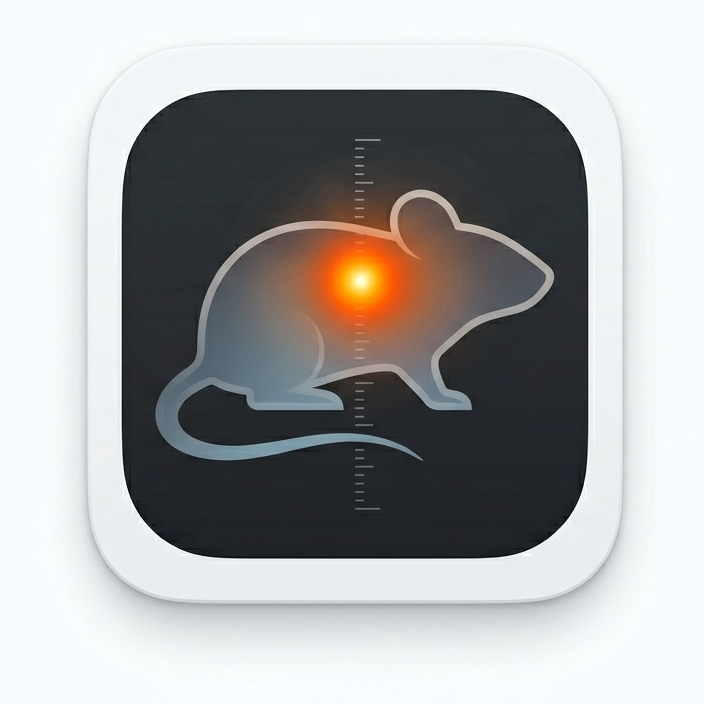

<p align="center">
  
</p>

<h1 align="center">Glöd — Parallel Thermal Imaging Analysis</h1>

<p align="center">
  <em>A desktop application for long-term, parallelised body temperature experiments in rodents.</em>
</p>

---

Glöd lets researchers in **neuroscience, metabolic syndrome, endocrinology**, and related fields run multiple thermal cameras simultaneously, then analyse all recordings in one place — from raw sensor CSV files to publication-ready figures and statistical tests.
No coding required. Point it at your data folders, configure your groups, click **Run**.

Built with Waveshare MI48x3 thermal cameras and tested at Karolinska Institutet.

---

## About the Name

*Glöd* is Swedish for **glow** or **live embers** — evoking both the warm hotspots visible in thermal imagery and the slow, sustained physiological processes the tool is designed to track. The Scandinavian aesthetic carries through into the UI theme.

---

## Who Is This For?

Glöd is designed for researchers who:

- Study **thermoregulation**, **circadian rhythms**, **fever responses**, **metabolic syndrome**, or **endocrine function** in rodents
- Need to run **long-term parallel recordings** across multiple animals or experimental groups simultaneously
- Want a **single pipeline** from raw camera output to statistical results and publication-worthy graphs — without writing custom analysis code

The target organisms are mice and rats, though sensor dimensions, FPS, and ROI parameters are all user-configurable.

---

## Hardware Setup

This project was developed using three **[Waveshare Thermal USB Cameras (B)](https://www.waveshare.com/wiki/Thermal_USB_Camera_(B)?srsltid=AfmBOoreoDCSu5Yau3DvoxuaR3LtRhWDU4QvdC0lfTemWEkDUbIstE-_)** running in parallel — one camera per animal or cage.

Each camera:
- Costs ~$50 USD — budget-friendly for multi-animal setups
- Uses the **MI48x3** sensor at 80 × 62 px (nominal 10 FPS; ≈ 6 FPS measured on our rig — Glöd uses the measured rate)
- Connects via USB and records directly to CSV files via the Waveshare software

Running three cameras simultaneously enables true parallel data collection from multiple experimental groups with no synchronisation overhead.

---

## Quick Start

```bash
conda activate glod
python run_glod.py
```

---

## Environment

| Item | Value |
|---|---|
| Conda env | `glod` (created with `conda create -n glod python=3.11`) |
| Python | 3.11 |
| Key packages | PyQt6 · matplotlib · numpy · scipy · pandas · opencv-python-headless · statsmodels · scikit-posthocs |

To recreate the environment from scratch:

```bash
conda create -n glod python=3.11 -y
conda activate glod
pip install PyQt6 matplotlib numpy scipy pandas opencv-python-headless statsmodels scikit-posthocs pillow
```

---

## Camera / Data Format

**Waveshare Thermal USB Camera (B) — MI48x3 sensor**

| Parameter | Value |
|---|---|
| Resolution | 80 × 62 pixels = 4 960 px/frame |
| Data format | CSV, no header; 4 968 columns/line |
| Metadata cols | 0–7 (ISO timestamp + 7 values) |
| Pixel cols | 8–4967 (float °C values) |
| FPS | nominal 10; the real rate is measured from the timestamps |

The UI lets you override Width, Height, and metadata column count to support other sensors.

---

## Project Structure

```
glod/
├── run_glod.py                       # top-level launcher
└── thermal_analysis/
    ├── ui/                           # main window, group cards, live capture, theme
    ├── processing/
    │   ├── mouse_tracker.py          # body segmentation, frame gating, head readout, activity
    │   ├── parser.py                 # CSV parser (parallel), measured frame rate, emissivity, T_core
    │   ├── roi_analysis.py           # emissivity physics, baseline, T_core, NaN-safe helpers
    │   ├── stats.py                  # per-animal metrics, tracking QC, statistical tests
    │   ├── publication.py            # source-data CSVs, statistics report, README, manifest
    │   ├── workers.py                # QThread workers (ParseWorker, VideoWorker)
    │   └── video_exporter.py         # annotated video export
    ├── plotting/figure_builder.py    # figure builders
    └── utils/                        # config, naming, coat/emissivity presets
```

---

## Usage

1. Launch the app and pick a **project folder** (recordings and results live inside it).
2. **Record** tab: capture from the cameras (**⏸ Pause** / **▶ Resume** at any time — the live view keeps running, nothing is recorded while paused, and the analysis continues from where the recording stopped as if nothing happened), or go to **Analyse** for existing files.
3. **Add Group** — name it, pick a colour, browse to the folder of `.txt` recordings, and choose the **Animal / coat** (default *Mouse · C57BL/6*; presets for other strains, rats, bare skin, or a custom ε).
4. Defaults are right for a normal experiment: **Body (auto-tracking)** ROI, **90 s settling period** excluded, animals tracked in < 50 % of frames excluded from statistics. Advanced settings are collapsed.
5. Optionally set time points to compare, tick **paired design** (auto-detected when animal names repeat across groups), and tick **Export video**.
6. Click **▶ Run Analysis**. Everything is saved automatically into `<project>/analysis/<date_time>/`.

---

## Output Files

```
<project>/analysis/YYYY-MM-DD_HHMMSS/
├── data/            per-animal ROI + T_core time series, group summaries (CSV)
├── plots/           figures (PNG, 150 dpi)
├── source_data/     one CSV per figure — the exact plotted values
├── statistics/      per-animal metrics, tracking_qc, descriptive stats, normality, tests,
│                    post-hoc, statistics_report.md (with suggested methods text)
├── videos/          group tile + per-animal videos (outline, live trace, colourbar)
├── settings.json    every parameter used, incl. emissivity per group
├── log.txt  README.txt  <date>_analysis_manifest.csv (SHA-256 of inputs)
```

---

## Algorithms

### Body tracking (default)
Per frame: Gaussian smoothing → adaptive Otsu threshold (limited to ±1 °C of the recording median) → opening to remove the tail → largest component = body. The reading is the hottest pixel of the eroded body core. Frames in which the body is mostly out of view, merged with bedding, edge-clipped, low-contrast or a statistical outlier are **rejected and shown as gaps, never as dips**. Gaps ≤ 2 s are bridged; nothing longer is filled in.

### Timing
All windows are in seconds using the **frame rate measured from the file timestamps** (≈ 6 Hz on the reference rig, not the nominal 10). The Savitzky-Golay window, T_core blocks and video playback are rescaled accordingly.

### Pauses
If a recording was paused and resumed, the file is analysed as **one continuous recording**: the pause is cut out of the time axis (the raw timestamps stay in the file, the number and length of pauses are listed in the tracking-QC table, and a thin dotted marker shows the join in the animal overview).

### Settling period
The first 90 s after placing the animal are excluded from baseline, T_core, group curves and statistics (shaded grey in plots). On the reference recordings the body signal ran 0.3–0.5 °C low for ~45–90 s.

### Emissivity
`T_true⁴ = (ε_sensor·T_obs⁴ + (ε_true − ε_sensor)·T_refl⁴) / ε_true` (kelvin; reflected temperature from the image background). `ε_sensor` = 0.95, the camera's EMISSIVITY register (read from all three cameras). Applied to the temperature series only; estimated T_core uses the uncorrected values its regression was calibrated on. Fur ε in the literature spans 0.86–0.98 and **no coat-colour-specific values exist**, so the choice is a near-constant offset (ε 0.86 → +0.85 °C, ε 0.98 → −0.25 °C at 30.5 °C): it matters for absolute temperatures and cross-strain comparisons, hardly for within-animal changes. Sources: `thermal_analysis/utils/coat_presets.py`.

### Per-animal metrics (one value per animal)
Mean body temperature (all frames and resting-only), head temperature (secondary), mean/peak change from baseline, robust slope (Theil–Sen, °C/min), mean T_core, mean speed and % time moving. Each is built from 30-s bin means of tracked frames (bins with < 20 % tracked frames are dropped) so well-tracked periods cannot dominate.

### Tracking quality and untracked frames
`statistics/*_tracking_qc.csv` and the *Tracking quality* plot list, per animal, the % of frames tracked, the longest gap and a **visibility check**: the correlation between how much of a 30-s window was tracked and its temperature. A flag (⚠) means temperature depends on visibility — a possible selection bias even when overall coverage is high — and each flagged animal gets a plain-language explanation under its plots and in the report.

### T_core Estimation — van der Vinne et al. (2020) *Sci Rep* 10:20680
Maximum T_skin per 60-s block → 30-min rolling mean → **T_core = 0.93 × T_skin,max + 7.1 °C**.
> ⚠ Between-animal error ≈ ±0.9 °C: use for within-animal changes and group comparisons, not absolute core temperature.

### Statistics
Small-n friendly policy: parametric by default (Welch t / ANOVA, paired t / RM-ANOVA for paired designs); rank tests only when Shapiro–Wilk fails *and* the rank test can reach p < 0.05 at that n. Post-hoc: Tukey HSD / Dunn + Holm. Holm across metrics is reported alongside. Optional time-point comparisons (≤ 3) with within-group tests.

---

## Plots Generated

| Plot | Description |
|---|---|
| Temperature change | Δ°C from each animal's baseline: every animal + group mean ± SEM |
| Absolute temperature | Same in °C |
| Estimated T_core | T_skin,max and T_core: animals + group mean ± SEM |
| Tracking quality | % tracked per animal, with a plain-language note for any flag |
| Animal *name* (one per recording) | Temperature (+ head, untracked stretches shaded), speed, tracked raster, time-in-view heat-map, visibility-check scatter |
| Time-point comparison | Grouped bars (when time points are set) |
| Group comparison | Bars + individual animals + significance (2+ groups) |

---

## Known Limitations

- With only 1 file per group SEM is undefined; with n = 3 per group statistics are descriptive at best.
- Estimated T_core needs ≥ 30 min for the rolling window to fill; shorter recordings use fewer blocks.
- Skin temperature of moving animals reads lower than at rest on the reference data (opposite to some published home-cage findings); report activity alongside temperature and use the resting-only metric as a sensitivity analysis.
- The 90-s settling period and the emissivity presets are defaults from n = 3 recordings and the literature; check them against your own protocol.
- The IDE (VS Code) may show false "Cannot find module PyQt6" errors because it uses the system Python 3.9; the app runs correctly in the `glod` conda env.

---
## AI Disclaimer

Parts of this codebase were developed with the assistance of AI tools (Claude by Anthropic). All experimental design, scientific decisions, and algorithmic choices were made by the researcher; AI assistance was used for implementation, code review, and debugging.
